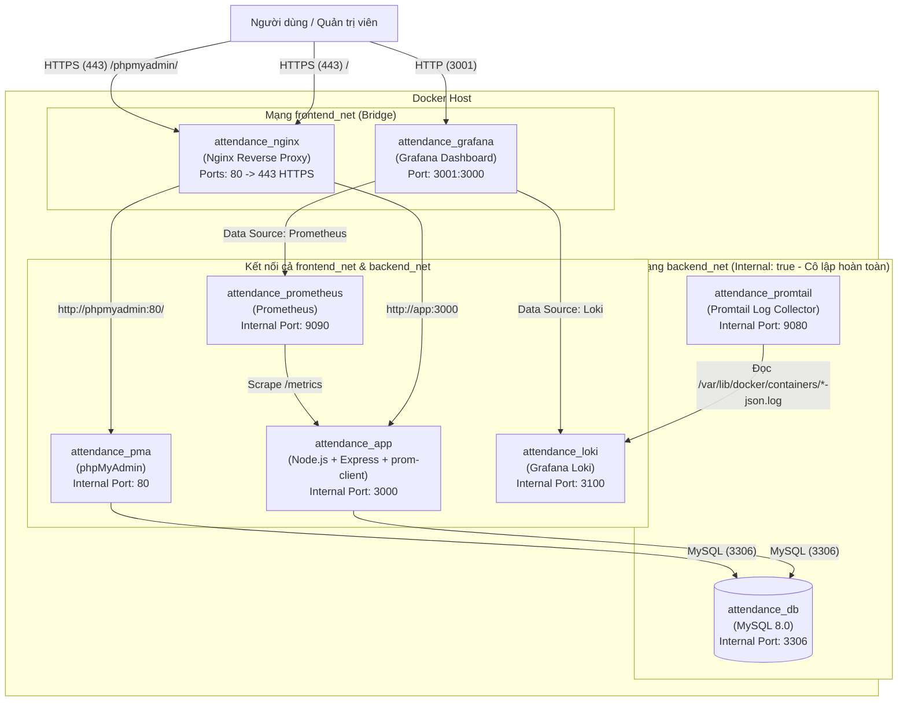

# Hệ Thống Điểm Danh Sinh Viên (Student Attendance System)

Dự án triển khai **Hệ Thống Điểm Danh Sinh Viên** hoàn chỉnh trên nền tảng container hóa với **Docker Compose**, tích hợp **Nginx Reverse Proxy (HTTPS)**, cơ sở dữ liệu **MySQL 8.0**, công cụ quản trị **phpMyAdmin**, hệ thống giám sát **Prometheus + Grafana**, hệ thống quản lý log tập trung **Loki + Promtail**, và áp dụng các biện pháp bảo mật **System Hardening**.

---

## 1. Thông Tin Sinh Viên Thực Hiện

* **Họ và tên:** Mẫn Bá Hảo
* **Mã số sinh viên:** `DTC245220031`
* **Email:** `Dtc245220031@Ictu.edu.vn`
* **Repository GitHub:** [https://github.com/Harodeptry/Dtc245220031_ManBaHao.git](https://github.com/Harodeptry/Dtc245220031_ManBaHao.git)
* **Đề tài:** Triển khai ứng dụng Web Điểm Danh Sinh Viên, Reverse Proxy, Giám sát (Monitoring), Log tập trung (Centralized Logging) và Bảo mật hệ thống (Hardening) bằng Docker Compose.

---

## 2. Kiến Trúc Hệ Thống & Danh Sách Dịch Vụ

### 2.1. Sơ đồ kiến trúc mạng và dịch vụ

Hệ thống được phân tách thành 2 mạng Docker riêng biệt để đảm bảo an toàn bảo mật:
* **`frontend_net` (Bridge):** Mạng giao tiếp cho các dịch vụ cần kết nối qua Reverse Proxy hoặc giao diện quản trị.
* **`backend_net` (Bridge - `internal: true`):** Mạng nội bộ cô lập hoàn toàn với Internet bên ngoài, nơi đặt cơ sở dữ liệu MySQL và luồng thu thập log/metrics nội bộ.



### 2.2. Danh sách các Container trong hệ thống

| Tên Container | Service | Image | Cổng (Host:Container) | Mạng (Network) | Vai trò |
| :--- | :--- | :--- | :---: | :--- | :--- |
| `attendance_nginx` | `nginx` | `nginx:alpine` | `80:80`, `443:443` | `frontend_net` | Reverse Proxy, SSL/TLS Termination, gắn Security Headers |
| `attendance_app` | `app` | Build từ `./app` (`node:18-alpine`) | Nội bộ (`3000`) | `frontend_net`, `backend_net` | Ứng dụng Web Điểm Danh Sinh Viên & cung cấp `/metrics` |
| `attendance_db` | `db` | `mysql:8.0` | Nội bộ (`3306`) | `backend_net` | Cơ sở dữ liệu MySQL lưu trữ danh sách điểm danh (`checkins`) |
| `attendance_pma` | `phpmyadmin` | `phpmyadmin/phpmyadmin` | Nội bộ (`80`) | `frontend_net`, `backend_net` | Công cụ quản trị cơ sở dữ liệu MySQL qua giao diện Web |
| `attendance_prometheus` | `prometheus` | `prom/prometheus:v2.45.0` | `9090:9090` | `frontend_net`, `backend_net` | Thu thập và lưu trữ chuỗi thời gian (metrics) từ Container, Web & DB |
| `attendance_grafana` | `grafana` | `grafana/grafana:10.0.0` | `3001:3000` | `frontend_net` | Trực quan hóa Dashboard giám sát (Prometheus) và truy vấn Log (Loki) |
| `attendance_loki` | `loki` | `grafana/loki:2.8.4` | Nội bộ (`3100`) | `frontend_net`, `backend_net` | Hệ thống lưu trữ và lập chỉ mục log tập trung |
| `attendance_promtail` | `promtail` | `grafana/promtail:2.8.4` | Nội bộ (`9080`) | `backend_net` | Agent thu thập log từ Docker containers và đẩy về Loki |

---

## 3. Cấu Trúc Thư Mục Dự Án

```text
Dtc245220031_ManBaHao/
├── app/
│   ├── Dockerfile              # Đóng gói ứng dụng Node.js với non-root user (USER node)
│   ├── package.json            # Khai báo dependencies: express, mysql2, prom-client
│   └── server.js               # Mã nguồn Web App điểm danh & endpoint /metrics (App + DB)
├── grafana/
│   └── provisioning/
│       ├── datasources/
│       │   └── datasources.yml # Tự động cấu hình nguồn dữ liệu Prometheus & Loki
│       └── dashboards/
│           ├── dashboards.yml  # Cấu hình nạp Dashboard tự động
│           └── attendance-dashboard.json # Dashboard giám sát Container, Web, DB & Logs
├── loki/
│   ├── loki-config.yml         # Cấu hình lưu trữ và schema cho Loki
│   └── promtail-config.yml     # Cấu hình Promtail đọc Docker JSON logs & gán nhãn container_name
├── nginx/
│   ├── default.conf            # Cấu hình Reverse Proxy, chuyển hướng HTTPS & Security Headers
│   └── ssl/
│       ├── nginx.crt           # Chứng chỉ số SSL tự ký (Self-signed Certificate)
│       └── nginx.key           # Khóa bí mật SSL (Private Key)
├── prometheus/
│   └── prometheus.yml          # Cấu hình các scrape jobs thu thập metrics
├── .gitattributes              # Đồng bộ chuẩn ký tự xuống dòng LF trên Linux/Ubuntu
├── docker-compose.yml          # File điều phối toàn bộ 8 dịch vụ, mạng và volumes
└── README.md                   # Tài liệu hướng dẫn triển khai và sử dụng hệ thống
```

---

## 4. Hướng Dẫn Cài Đặt và Khởi Chạy Hệ Thống

### 4.1. Yêu cầu môi trường
* Hệ điều hành: Linux (Ubuntu/Debian/CentOS) hoặc Windows/macOS có cài đặt **Docker Engine** và **Docker Compose v2**.
* Các cổng `80`, `443`, `3001`, `9090` trên máy chủ không bị chiếm dụng bởi tiến trình khác.

### 4.2. Các bước triển khai

**Bước 1: Sao chép mã nguồn từ GitHub**
```bash
git clone https://github.com/Harodeptry/Dtc245220031_ManBaHao.git
cd Dtc245220031_ManBaHao
```

**Bước 2: Khởi dựng và chạy toàn bộ dịch vụ bằng Docker Compose**
```bash
docker compose up -d --build
```

**Bước 3: Kiểm tra trạng thái các container**
```bash
docker compose ps
```
Đảm bảo cả 8 containers (`attendance_nginx`, `attendance_app`, `attendance_db`, `attendance_pma`, `attendance_prometheus`, `attendance_grafana`, `attendance_loki`, `attendance_promtail`) đều ở trạng thái `Up` / `Running`.

### 4.3. Bảng địa chỉ truy cập và Thông tin đăng nhập

| Dịch vụ | Địa chỉ truy cập (URL) | Tài khoản | Mật khẩu | Ghi chú |
| :--- | :--- | :---: | :---: | :--- |
| **Web App Điểm Danh** | `https://localhost` *(hoặc `http://localhost` tự chuyển sang HTTPS)* | *(Không yêu cầu)* | *(Không yêu cầu)* | Chấp nhận cảnh báo chứng chỉ tự ký trên trình duyệt |
| **phpMyAdmin (Quản lý DB)** | `https://localhost/phpmyadmin/` | `att_user` *(hoặc `root`)* | `StrongP@ssw0rd2026` *(hoặc `RootSecurePass2026!`)* | Đi qua Nginx Reverse Proxy HTTPS |
| **Grafana (Monitoring & Log)** | `http://localhost:3001` | `admin` | `AdminStrongPass2026!` | Đã tích hợp sẵn Data Sources & Dashboard tự động |
| **Prometheus UI** | `http://localhost:9090` | *(Không yêu cầu)* | *(Không yêu cầu)* | Kiểm tra `Status -> Targets` (`attendance-app` & `prometheus`) |

---

## 5. Hướng Dẫn Cấu Hình & Kiểm Tra Từng Yêu Cầu Đề Bài

### 5.1. Kiểm tra Nginx Reverse Proxy, HTTPS & Security Headers (Yêu cầu 3)
* Khi truy cập `http://localhost`, Nginx trả về mã `301 Moved Permanently` chuyển hướng tự động sang `https://localhost`.
* Kiểm tra nhanh bằng lệnh `curl` trên terminal:
  ```bash
  curl -I -k https://localhost
  ```
* Kết quả trả về sẽ hiển thị đầy đủ các **Security Headers** đã cấu hình trong `nginx/default.conf`:
  ```http
  HTTP/1.1 200 OK
  Server: nginx
  X-Frame-Options: SAMEORIGIN
  X-XSS-Protection: 1; mode=block
  X-Content-Type-Options: nosniff
  ```

---

### 5.2. Giám sát với Prometheus + Grafana (Yêu cầu 4)

1. **Cơ chế thu thập Metrics (Container, Web Server & Database):**
   * Ứng dụng Node.js (`app/server.js`) sử dụng thư viện `prom-client` mở endpoint `/metrics`, cung cấp:
     * **Metrics tài nguyên Container/Tiến trình:** `process_cpu_seconds_total`, `process_resident_memory_bytes`, `nodejs_heap_size_used_bytes`, `nodejs_eventloop_lag_seconds`, v.v.
     * **Metrics lưu lượng Web Server:** `http_requests_total{method, route, status}` đếm tổng số lượt truy cập trang chủ (`GET /`) và số lượt điểm danh thành công (`POST /checkin`).
     * **Metrics giám sát MySQL Database:** `mysql_db_up` (trạng thái kết nối DB `1 = UP`, `0 = DOWN`) và `mysql_checkins_records_total` (tổng số bản ghi điểm danh hiện có trong bảng `checkins`).
2. **Tự động nạp Data Source & Dashboard trên Grafana (`http://localhost:3001`):**
   * Dự án đã cấu hình sẵn **Grafana Provisioning** trong thư mục `grafana/provisioning/`. Ngay khi khởi chạy, hai nguồn dữ liệu **Prometheus** (`http://prometheus:9090`) và **Loki** (`http://loki:3100`) cùng bộ Dashboard **"Hệ Thống Điểm Danh Sinh Viên - Giám Sát Toàn Diện"** đã được nạp tự động.
   * Bạn chỉ cần đăng nhập Grafana (`admin` / `AdminStrongPass2026!`) $\rightarrow$ vào mục **Dashboards** để xem ngay toàn bộ biểu đồ.
3. **Các câu truy vấn PromQL tiêu biểu:**
   * Kiểm tra trạng thái hoạt động của MySQL Database và tổng số bản ghi điểm danh:
     ```promql
     mysql_db_up
     mysql_checkins_records_total
     ```
   * Tổng số lượt truy cập và điểm danh theo từng route trên Web Server:
     ```promql
     http_requests_total
     ```
   * Dung lượng RAM sử dụng của container ứng dụng (MB):
     ```promql
     process_resident_memory_bytes{job="attendance-app"} / 1024 / 1024
     ```
   * Mức sử dụng CPU của container:
     ```promql
     rate(process_cpu_seconds_total{job="attendance-app"}[1m])
     ```

---

### 5.3. Hệ thống Log tập trung Loki + Promtail & Truy vấn LogQL (Yêu cầu 5)

1. **Cơ chế thu thập Log & Gán nhãn (`loki/promtail-config.yml`):**
   * Promtail đọc log JSON của toàn bộ Docker containers, trích xuất `attrs.tag` và tự động gắn nhãn `container_name` (`app`, `nginx`, `db`, `pma`, `prometheus`, `grafana`, `loki`, `promtail`) cùng nhãn `container` (`attendance_app`, `attendance_nginx`,...).
2. **Truy vấn Log bằng LogQL (Vào mục Explore trên Grafana $\rightarrow$ chọn nguồn dữ liệu Loki):**
   Dưới đây là **5 câu truy vấn LogQL** từ cơ bản đến nâng cao để kiểm tra và trích xuất log:

   * **Query 1 — Xem toàn bộ log thu thập từ tất cả các container Docker trong hệ thống:**
     ```logql
     {job="docker_logs"}
     ```
   * **Query 2 — Xem riêng log của container ứng dụng Web (`app`) hoặc Reverse Proxy (`nginx`):**
     ```logql
     {container_name="app"}
     ```
     *(hoặc `{container_name="nginx"}`, `{container_name="db"}`)*
   * **Query 3 — Lọc riêng các dòng log phát sinh khi có sinh viên thực hiện điểm danh (`[CHECKIN]`):**
     ```logql
     {container_name="app"} |= "[CHECKIN]"
     ```
   * **Query 4 — Tìm kiếm lịch sử điểm danh của một sinh viên cụ thể (theo Mã SV hoặc Họ tên bằng biểu thức chính quy):**
     ```logql
     {job="docker_logs"} |= "[CHECKIN]" |~ "DTC245220031|Man Ba Hao"
     ```
   * **Query 5 — Thống kê số lượt điểm danh thành công theo từng khoảng thời gian 5 phút (Metric Query trên LogQL):**
     ```logql
     count_over_time({job="docker_logs"} |= "[CHECKIN]" [5m])
     ```

---

### 5.4. Các biện pháp Bảo mật hệ thống - System Hardening (Yêu cầu 6)

Dự án đã triển khai **5 lớp bảo mật (Hardening)** theo đúng tiêu chuẩn an toàn thông tin:

1. **Non-root Container (Chạy ứng dụng với quyền người dùng thường):**
   * Trong `app/Dockerfile`, cấu hình chỉ thị `USER node` trước khi chạy `CMD ["node", "server.js"]`. Nếu ứng dụng bị khai thác lỗ hổng thực thi mã từ xa (RCE), kẻ tấn công cũng không có quyền `root` bên trong container.
2. **Network Isolation (Cô lập mạng nội bộ):**
   * Cấu hình mạng `backend_net` với thuộc tính `internal: true` trong `docker-compose.yml`.
   * Container cơ sở dữ liệu `attendance_db` chỉ được gắn vào `backend_net` và **không mở cổng `3306` ra máy host**, ngăn chặn mọi kết nối trực tiếp từ bên ngoài vào Database.
   * Container `attendance_app` và `attendance_pma` cũng không mở cổng trực tiếp ra host mà bắt buộc phải đi qua cổng kiểm soát duy nhất là `attendance_nginx`.
3. **Chính sách mật khẩu mạnh (Strong Passwords):**
   * Toàn bộ mật khẩu của MySQL Root (`RootSecurePass2026!`), MySQL User (`StrongP@ssw0rd2026`) và Grafana Admin (`AdminStrongPass2026!`) đều có độ dài $\ge 16$ ký tự, kết hợp chữ hoa, chữ thường, chữ số và ký tự đặc biệt.
4. **Hạn chế quyền tối thiểu (Principle of Least Privilege & Read-Only Volumes):**
   * Ứng dụng Web kết nối vào MySQL bằng tài khoản riêng `att_user` (chỉ có quyền thao tác trên database `attendance_db`) thay vì dùng tài khoản quản trị tối cao `root`.
   * Toàn bộ các file cấu hình mount từ máy host vào container (`default.conf`, `ssl/`, `prometheus.yml`, `loki-config.yml`, `promtail-config.yml`, `/var/lib/docker/containers`) đều được gắn cờ **`:ro` (Read-Only)** để chống việc sửa đổi trái phép từ bên trong container.
   * Truy vấn SQL trong `app/server.js` sử dụng **Prepared Statements** (`VALUES (?, ?)`) chống tấn công SQL Injection.
5. **Mã hóa truyền dẫn HTTPS & HTTP Security Headers trên Nginx:**
   * Mã hóa toàn bộ lưu lượng truy cập bằng SSL/TLS (`nginx.crt`, `nginx.key`) và tự động ép buộc chuyển hướng từ HTTP sang HTTPS.
   * Tích hợp 3 Security Headers bảo vệ trình duyệt người dùng:
     * `X-Frame-Options: SAMEORIGIN` (Chống tấn công Clickjacking).
     * `X-XSS-Protection: 1; mode=block` (Kích hoạt bộ lọc chống Cross-Site Scripting).
     * `X-Content-Type-Options: nosniff` (Chống tấn công MIME-sniffing).

---

## 6. Lịch Sử Commit Triển Khai Dự Án

Quá trình phát triển dự án được quản lý qua các mốc commit rõ ràng theo yêu cầu đề bài:
* **Commit 1 (`98dc947`):** Triển khai Web App Điểm Danh Sinh Viên, MySQL, phpMyAdmin, Nginx Reverse Proxy HTTPS và Hardening cơ bản.
* **Commit 2 (`6b542a8`):** Tích hợp hệ thống giám sát Prometheus và Grafana thu thập metrics container và ứng dụng.
* **Commit cập nhật UI (`76ff6ec`):** Nâng cấp giao diện người dùng Web App trực quan, hiện đại.
* **Commit 3 (`71d2f11`):** Triển khai hệ thống thu thập log tập trung với Loki và Promtail, phục vụ truy vấn LogQL.
* **Commit 4 (`97219ee`):** Hoàn thiện tích hợp phpMyAdmin qua Nginx HTTPS và tối ưu cấu hình hệ thống giám sát/log.

---

## 7. Các Lệnh Quản Trị Hữu Ích

```bash
# Xem log trực tiếp của toàn bộ hệ thống
docker compose logs -f

# Xem log riêng của ứng dụng điểm danh
docker compose logs -f app

# Khởi động lại một dịch vụ cụ thể (ví dụ: nginx)
docker compose restart nginx

# Dừng toàn bộ hệ thống (vẫn giữ nguyên dữ liệu Database)
docker compose down

# Dừng hệ thống và xóa toàn bộ dữ liệu volume (reset sạch từ đầu)
docker compose down -v
```
